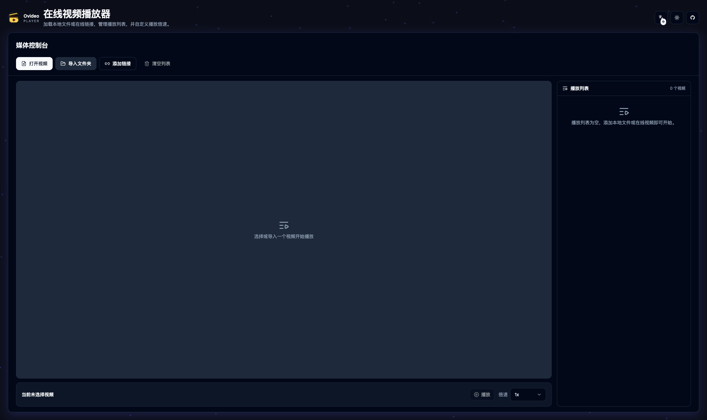

# Ovideo

<div align="center">
  <h3>🎬 Modern Web Video Player</h3>
  <p>A feature-rich online video player with playlist management and playback controls</p>

  <p>
    
    
    
    
    
  </p>
</div>

---



## ✨ Features

### 🎯 Core Functionality
- **📁 Local File Support** - Import single or multiple video files with automatic playlist generation
- **🗂️ Folder Import** - Bulk import entire directories while preserving relative paths
- **🌐 Remote Streaming** - Add online video URLs (HTTP/HTTPS) and mix with local files
- **📋 Playlist Management** - Quick switching between playlist items with current item highlighting
- **⚡ Playback Controls** - Variable speed playback (0.5x - 2x) with consistent cross-platform experience

### 🎨 User Experience
- **🌓 Theme Support** - Automatic dark/light theme switching
- **🌍 Internationalization** - Multi-language support (English/Chinese)
- **📱 Responsive Design** - Optimized for desktop and mobile devices
- **🎪 Drag & Drop** - Intuitive file dropping interface
- **🔄 Modern UI** - Built with shadcn/ui and Radix Primitives
- **📲 PWA Support** - Installable as a native app with offline capabilities

## 🚀 Getting Started

### Prerequisites

- Node.js 18+ 
- npm or yarn

### Installation

1. **Clone the repository**
   ```bash
   git clone https://github.com/honkinglin/ovideo.git
   cd ovideo
   ```

2. **Install dependencies**
   ```bash
   npm install
   ```

3. **Start development server**
   ```bash
   npm run dev
   ```

4. **Open your browser**
   Navigate to `http://localhost:5173`

## 📱 PWA Features

Ovideo is a Progressive Web App (PWA) that can be installed on your device for a native app-like experience:

### Installation
- **Desktop**: Look for the install prompt in the address bar or the install button in the app
- **Mobile**: Use "Add to Home Screen" option in your browser menu
- **Automatic Updates**: The app will prompt you when updates are available
- **Brand Consistency**: Uses the project logo for all PWA icons across different platforms

### Offline Capabilities
- **Service Worker Caching**: Static assets are cached for offline access
- **Font Caching**: Google Fonts are cached for consistent typography
- **Background Updates**: App updates in the background when connected

### Cross-Platform Support
- **Desktop**: Windows, macOS, Linux (Chrome, Edge, Firefox)
- **Mobile**: iOS (Safari), Android (Chrome, Samsung Internet)
- **Responsive**: Adapts to different screen sizes and orientations

## 🔧 Development

### Available Scripts

- `npm run dev` - Start development server with HMR
- `npm run build` - Build for production
- `npm run preview` - Preview production build
- `npm run lint` - Run ESLint

### Project Structure

```
src/
├── components/
│   ├── ui/                    # shadcn/ui components
│   │   ├── button.tsx
│   │   ├── card.tsx
│   │   ├── dialog.tsx
│   │   └── ...
│   └── video-player/          # Main video player components
│       ├── index.tsx          # Main player component
│       ├── controls-toolbar.tsx
│       ├── player-surface.tsx
│       ├── playlist-panel.tsx
│       └── hooks/             # Custom React hooks
│           ├── use-video-playback.ts
│           ├── use-video-playlist.ts
│           └── ...
├── lib/
│   └── utils.ts              # Utility functions
└── assets/                   # Static assets
```

### Tech Stack

- **Framework**: React 19 with TypeScript
- **Build Tool**: Vite
- **Styling**: Tailwind CSS with CSS Variables
- **UI Components**: shadcn/ui + Radix UI Primitives
- **Video Processing**: mpegts.js for MPEG-TS support
- **Icons**: Lucide React
- **State Management**: React Hooks (useState, useReducer)
- **PWA**: Vite PWA Plugin with Workbox for Service Worker and caching

## 🚀 Deployment

### Build for Production

```bash
npm run build
```

The built files will be in the `dist/` directory, ready for deployment to any static hosting service.

### Deploy to Popular Platforms

<details>
<summary><strong>Vercel</strong></summary>

1. Push your code to GitHub
2. Connect your repository to Vercel
3. Deploy automatically on every push

</details>

<details>
<summary><strong>Netlify</strong></summary>

1. Build the project: `npm run build`
2. Drag and drop the `dist` folder to Netlify
3. Or connect your Git repository for automatic deployments

</details>

<details>
<summary><strong>GitHub Pages</strong></summary>

1. Install gh-pages: `npm install --save-dev gh-pages`
2. Add deploy script to package.json:
   ```json
   "scripts": {
     "deploy": "gh-pages -d dist"
   }
   ```
3. Run: `npm run build && npm run deploy`

</details>

## 📄 License

This project is licensed under the MIT License - see the [LICENSE](LICENSE) file for details.

## 🙏 Acknowledgments

- [shadcn/ui](https://ui.shadcn.com/) for the beautiful UI components
- [Radix UI](https://www.radix-ui.com/) for accessible primitives
- [Lucide](https://lucide.dev/) for the icon system
- [mpegts.js](https://github.com/xqq/mpegts.js) for MPEG-TS support

---

<div align="center">
  <p>Made with ❤️ by <a href="https://github.com/honkinglin">honkinglin</a></p>
  <p>⭐ Star this repository if you find it helpful!</p>
</div>
